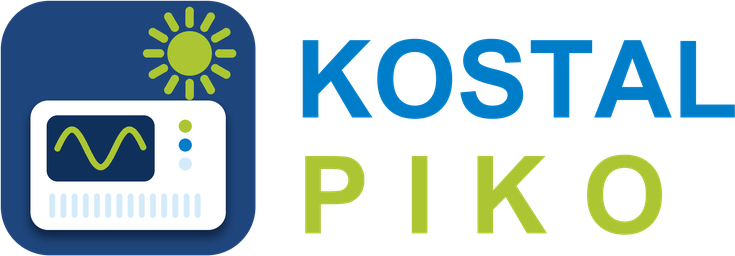

  

<h1 align="center">Kostal Piko</h1>

  Home Assistant integration for Kostal Piko inverters – values from the inverter's web interface, fully configurable from the UI.

  
  
  
  
  
  
  

  
  
  

<em><a href="README.md">🇩🇪 Deutsche Version</a></em>

A UI-configurable Home Assistant custom integration for **Kostal Piko inverters** with a web interface. It reads the values of the inverter's web interface (`/index.fhtml`) with its own asynchronous client (reading the pages is based on the [`kostalpiko`](https://github.com/rcasula/kostalpiko) library, see [Acknowledgements](#acknowledgements)) and exposes them as `sensor` entities. The integration uses a config flow, a shared `DataUpdateCoordinator` and typed sensors with `device_class` and `state_class` – so long-term statistics and the Energy dashboard work.

This project builds on [rcasula/kostalpiko-homeassistant](https://github.com/rcasula/kostalpiko-homeassistant) (see [Acknowledgements](#acknowledgements)). Entity IDs and `unique_id` of the existing sensors are unchanged, so the integration can be swapped without losing history or statistics (see [Switching from the upstream repository](#switching-from-the-upstream-repository)).

## Requirements

- Home Assistant **2025.8.0** or newer.
- A Kostal Piko inverter whose web interface is reachable on the network (default login: user `pvserver`, password `pvwr`).

## Installation

### Via HACS (recommended)

1. Use the first button to open the Kostal Piko repository in HACS.
2. Download **Kostal Piko** and restart Home Assistant.
3. Use the second button to add the integration. Alternatively, in Home
   Assistant open **Settings → Devices & Services → Add Integration →
   Kostal Piko**.

If the first button doesn't work, add `https://github.com/bertel2020/HA-kostal_piko`
under HACS → **Integrations → Custom repositories** with category
**Integration**.

### Manual

Copy the `custom_components/kostal` directory to
`/config/custom_components/kostal` and restart Home Assistant.

## Setup

Settings → Devices & Services → Add Integration → **Kostal Piko**.

1. **Name** (default `Kostal Piko`): becomes the title of the integration (`kostal_piko`) and the prefix of all entity IDs.
2. **Host**: address of the inverter **including** the protocol, e.g. `http://192.168.1.50`.
3. **Username / password**: login of the web interface (default `pvserver` / `pvwr`).
4. **Sensors**: choose the values for which entities are created.

The connection (including the credentials) is checked when saving. If the inverter is unreachable or the credentials are wrong, an error is shown. The same inverter cannot be added twice; its serial number is used as identifier.

The selection of sensors can be changed later with the **Configure** button of the integration. The integration then reloads; existing sensors keep their entity IDs.

Host, username and password can be changed via ⋮ → **Reconfigure** without deleting the integration. If the new address belongs to a different inverter (different serial number) the change is rejected. Entities and history are kept.

If the inverter is unreachable when Home Assistant starts, Home Assistant retries the setup automatically.

## Entities

One **device** (named after the title, manufacturer Kostal, model and serial number from the inverter) is created with the selected sensors. The entity ID is built from title and sensor name, so with the default settings it is `sensor.kostal_piko_<name>`.

| Sensor | Entity ID | Unit | Description |
|---|---|---|---|
| Current power | `sensor.kostal_piko_current_power` | W | Current AC power |
| Total energy | `sensor.kostal_piko_total_energy` | kWh | Total yield |
| Daily energy | `sensor.kostal_piko_daily_energy` | kWh | Daily yield |
| String 1/2/3 voltage | `sensor.kostal_piko_string_1_voltage` … | V | DC voltage per string |
| String 1/2/3 current | `sensor.kostal_piko_string_1_current` … | A | DC current per string |
| L1/L2/L3 voltage | `sensor.kostal_piko_l1_voltage` … | V | Grid voltage per phase |
| L1/L2/L3 power | `sensor.kostal_piko_l1_power` … | W | Power per phase |
| Status | `sensor.kostal_piko_status` | – | Operating state as text (e.g. "Einspeisen (MPP)") |
| Solar generator power | `sensor.kostal_piko_solar_generator_power` | W | Solar generator power (BA sensor required) |
| Consumption phase 1/2/3 | `sensor.kostal_piko_consumption_phase_1` … | W | Consumption per phase (BA sensor required) |
| String 1/2/3 power | `sensor.kostal_piko_string_1_power` … | W | **Calculated:** voltage × current per string |
| DC power | `sensor.kostal_piko_dc_power` | W | **Calculated:** sum of the string powers |
| Efficiency | `sensor.kostal_piko_efficiency` | % | **Calculated:** AC power ÷ DC power |

Sensor names are in English regardless of the UI language. Home Assistant assigns the entity ID once when the entity is first created and keeps it afterwards.

### Calculated sensors

The three calculated values do not come directly from the inverter but are derived from the string values. They replace template sensors that do the same calculation in `configuration.yaml` or as a helper.

- **String N power** = voltage × current, rounded to whole watts. If the inverter has fewer than three strings the value is "unknown".
- **DC power** = sum of the existing string powers.
- **Efficiency** = AC power ÷ DC power × 100, rounded to one decimal. Without DC input (standby) the value is "unknown" rather than 0 %, so averages are not skewed.

### Diagnostics

Under Settings → Devices & Services → Kostal Piko → ⋮ → **Download diagnostics** you get a JSON file with the state of the integration and the current sensor values. Host, username, password and serial number are redacted. It is well suited for bug reports.

### Behaviour on failure

All sensors are updated by a shared coordinator every 30 seconds (one request per interval, not per sensor). If the inverter does not respond once or twice, the sensors keep their last value. If **three polls in a row** fail (about 1.5 minutes), all sensors become **"unavailable"** and one error is written to the log. As soon as the inverter responds again the sensors become available and the recovery is logged once. This way no sensor presents stale values as current. A failure of the optional BA sensor does not make the other values unavailable.

In standby (at night) the inverter is reachable and reports the status "Aus" (off); the sensors stay available.

### BA sensor

The sensors *Solar generator power* and *Consumption phase 1/2/3* require a Kostal BA sensor (household consumption metering). If the BA page of the inverter only returns zeros the sensors show 0 W; if it returns no values they are "unknown".

## Switching from the upstream repository

If you use the repository `rcasula/kostalpiko-homeassistant` in HACS:

1. Create a **backup** in Home Assistant.
2. In HACS switch the repository to `bertel2020/HA-kostal_piko` (remove the old repository, add the new one as a custom repository and download **Kostal Piko**) and restart Home Assistant.
3. Check that the existing `sensor.kostal_piko_*` keep delivering values. **No** entities with a `_2` suffix should appear: names, `unique_id` and device are unchanged.

## Removal

Settings → Devices & Services → **Kostal Piko** → ⋮ → **Delete**. This removes the entities and the device from Home Assistant; history is kept according to the recorder settings. Afterwards the integration can be uninstalled in HACS via ⋮ → **Remove**. For a manual installation, delete the `custom_components/kostal` directory once no entries are left.

## YAML setup removed

The former setup via a `kostal:` block in `configuration.yaml` is no longer supported. Existing entries created through the UI or the earlier import keep working.

## Changelog

See [CHANGELOG.en.md](CHANGELOG.en.md).

## Acknowledgements

A heartfelt **thank you to [@rcasula](https://github.com/rcasula)**, the author of the original integration [kostalpiko-homeassistant](https://github.com/rcasula/kostalpiko-homeassistant). Without their work this project would not exist – it is based on their code and their idea of bringing Kostal Piko inverters into Home Assistant.

Reading the inverter pages comes from the [`kostalpiko`](https://github.com/rcasula/kostalpiko) library (MIT licence) and thus from **Tafkas** ([KostalPikoPy](https://github.com/Tafkas/KostalPikoPy)), **Giel Janssens** ([gieljnssns](https://github.com/gieljnssns/KostalPyko)) and the other contributors (maubreville, rcasula, britiger, Abildgren). Origin and licence text are in the file [NOTICE](NOTICE). Many thanks for that, too!

Thanks as well to [@m-rossi](https://github.com/m-rossi) for their contributions to the upstream project (daily energy for the Energy dashboard, adaptations to new Home Assistant versions, `state_class`/`device_class` of the sensors) and to everyone else who reported issues and contributed improvements there.

## Disclaimer

This is an independent, community-developed integration. It is not affiliated with Kostal and is neither supported nor endorsed by the manufacturer. It is provided **"as is", without warranty of any kind**; use it at your own risk. The integration only reads values and never writes anything to the inverter.

## Trademarks

"Kostal" and "Piko" as well as all other product and company names mentioned in this repository are trademarks or registered trademarks of their respective owners. They are mentioned solely to describe which hardware this integration is compatible with. "Home Assistant" is a trademark of the Open Home Foundation.

## Copyright & Licence

Copyright © 2026 bertel2020. Licensed under the [MIT License](LICENSE).

Originally derived from [rcasula/kostalpiko-homeassistant](https://github.com/rcasula/kostalpiko-homeassistant) (see [Acknowledgements](#acknowledgements)). The original repository contains no licence file.
